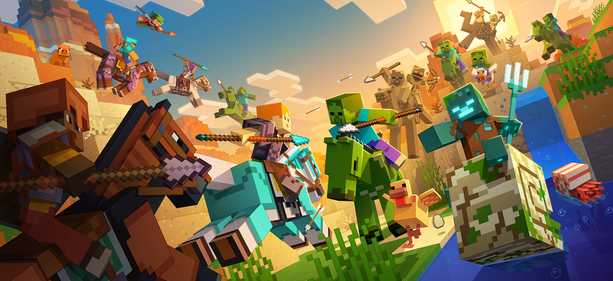
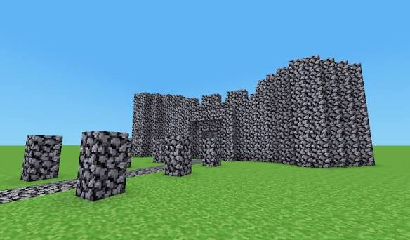
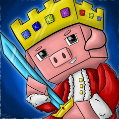

# От идеи до HTML-страницы

**Практическое занятие · 90 минут · команда из 3–4 человек**

Создайте одну HTML-страницу по техническому заданию своей команды. Один участник формулирует требования, второй создаёт страницу, третий проверяет результат. Если вас четверо, четвёртый готовит тексты и изображение.

Заполняйте строки `__________` прямо в этом файле. Код пишите в `index.html`. Используйте только знакомые теги; CSS — по желанию, он не обязателен.

## Шаг 1. Распределите роли — 5 минут

### Глоссарий
- **HTML — HyperText Markup Language**, язык гипертекстовой разметки: задаёт структуру страницы.
- **ТЗ — техническое задание**: описание того, что нужно сделать и как проверить результат.
- **Разработчик** создаёт страницу по ТЗ.
- **Тестировщик** проверяет страницу и записывает найденные ошибки.

### Заполните

Команда №: 1

Автор ТЗ, ФИО: Антонов Алексей  

Разработчик, ФИО: Кравченко Алексей

Тестировщик, ФИО: Майоров Тимофей

## Шаг 2. Выберите идею страницы — 5 минут

### Глоссарий
- **Целевая аудитория** — люди, для которых создаётся страница.
- **Содержание** — тексты, списки, изображения и ссылки на странице.

### Сделайте

Выберите одну тему:

- страница кружка или секции колледжа;
- приглашение на мероприятие;
- страница любимой игры, книги или фильма;
- памятка первокурснику;
- страница профессии;
- своя тема.

Тема: Своя тема(Minecraft)

Для кого создаём: Для посетителей

Что посетитель должен узнать: О истории обновлений "Minecraft" и его просторах

___________________________________________________________

## Шаг 3. Вспомните HTML — 10 минут

### Глоссарий
- **Тег** — обозначение элемента в угловых скобках: `<h1>`.
- **Атрибут** — дополнительное свойство тега: `href` задаёт адрес ссылки.
- **Браузер** — программа для просмотра страниц.
- **UTF-8** — кодировка, позволяющая корректно показывать русский текст.

### Изучите памятку

**Название вкладки** пишется внутри `<head>`:

```html
<title>Название страницы</title>
```

**Видимое содержание** пишется внутри `<body>`:

```html
<h1>Главный заголовок</h1>
<h2>Название раздела</h2>
<p>Один абзац текста.</p>

<ul>
  <li>Первый пункт</li>
  <li>Второй пункт</li>
  <li>Третий пункт</li>
</ul>


<p><a href="https://example.com">Название полезного сайта</a></p>
```

- `<h1>` — главный заголовок; в этом задании он один.
- `<h2>` — заголовок раздела.
- `<p>` — абзац.
- `<ul>` — маркированный список, `<li>` — его пункт.
- `` — изображение; `src` — путь к файлу, `alt` — текстовое описание.
- `<a>` — ссылка; `href` — адрес перехода.

Откройте `index.html` в редакторе и браузере. Найдите в коде заголовок и абзац. Измените абзац, сохраните файл и обновите страницу в браузере.

## Шаг 4. Автор ТЗ формулирует требования — 15 минут

### Глоссарий
- **Требование** — конкретное условие, которое должен выполнить разработчик.
- **Критерий приёмки** — признак, по которому проверяют выполнение требования.
- **Макет** — примерное расположение элементов страницы.

### Сделайте

Автор ТЗ заполняет поля ниже. Разработчик пока читает памятку, тестировщик изучает будущие требования. Затем вся команда согласовывает ТЗ.

Обязательная структура: название вкладки, один главный заголовок, два раздела с заголовками, два содержательных абзаца, список минимум из трёх пунктов, одно изображение с описанием и одна полезная внешняя ссылка.

### Техническое задание

Название вкладки: InterestingOfMinecraft

Главный заголовок: История обновлений Майнкрафта 

Первый раздел — заголовок: Самый первый snap shot

О чём первый абзац: О создании и создателе майнкрафта и как выглядела его первая версия, а так о первом самом масштабном обновлении.


Второй раздел — заголовок: Как развивались миры Майнкрафт

О чём второй абзац: Самые известные игроки и самые популярные во всем мире Миры(сервера)


Три пункта списка:

1. Фон основного сайта- зеленый
2. Обязательно 3 заголовка
3. ________________________________________________________

Файл изображения: 
                  
                  
                  

Что изображено, текст для `alt`: ___________________________

Адрес полезной ссылки: (https://dreamteam.fandom.com/ru/wiki/Technoblade)

Текст ссылки: Technoblade

Порядок элементов сверху вниз: ____________________________

___________________________________________________________

Одно дополнительное требование команды, которое можно проверить:

добавить страничку с иссторией игрока "Technoblade", критерий- обязательно должна быть дата смерти данного игрока а так же чем он занимался и чем прославился

Как проверим это требование: Проверить через сеть интеренет

___________________________________________________________

**Пример конкретного требования:** «В разделе “Расписание” указать день недели, время и кабинет». Критерий: «На странице присутствуют все три значения».

**Согласование:** разработчик объясняет своими словами, что он будет делать. Если чего-то не хватает, автор дополняет ТЗ до начала разработки.

## Шаг 5. Разработчик создаёт страницу — 25 минут

### Глоссарий
- **index.html** — имя основного файла страницы в этом задании.
- **Относительный путь** — путь к файлу относительно текущей страницы: `picture.svg` означает файл рядом с `index.html`.
- **Сохранение** — запись изменений в файл. Обновление браузера показывает сохранённую версию.

### Сделайте

1. Откройте `index.html` в редакторе.
2. Замените название вкладки и главный заголовок по ТЗ.
3. Добавьте два раздела с заголовками `<h2>` и абзацами `<p>`.
4. Добавьте список `<ul>` с минимум тремя элементами `<li>`.
5. Добавьте изображение. Можно использовать готовый `picture.svg` из папки. Если берёте своё, положите его рядом с HTML-файлом и укажите точное имя в `src`.
6. Добавьте полезную ссылку с понятной подписью.
7. Выполните дополнительное требование команды.
8. Сохраните файл. Откройте его в браузере и обновите страницу.

Пока разработчик пишет код, автор ТЗ готовит окончательные тексты, а тестировщик читает требования и составляет свои проверки в следующем шаге. Редактор, если есть, подбирает изображение и проверяет грамотность.

Если встретился незнакомый тег, используйте знакомый способ решения или уточните у преподавателя. Для выполнения задания не нужны JavaScript, сервер и установка дополнительных программ.

## Шаг 6. Тестировщик проверяет страницу — 15 минут

### Глоссарий
- **Тестирование** — проверка результата по требованиям.
- **Фактический результат** — то, что получилось при проверке.
- **Ошибка** — отличие результата от согласованного требования.
- **Повторная проверка** — проверка после исправления ошибки.

### Сделайте

Откройте страницу в браузере и сравните с ТЗ. Отмечайте `[x]` только после проверки.

- [ ] Название вкладки совпадает с ТЗ.
- [ ] Есть один главный заголовок, его текст совпадает с ТЗ.
- [ ] Есть два раздела с заголовками.
- [ ] Есть два содержательных абзаца по выбранной теме.
- [ ] В списке минимум три пункта, соответствующих ТЗ.
- [ ] Изображение отображается, в коде есть подходящий `alt`.
- [ ] Ссылка открывает адрес, указанный в ТЗ.
- [ ] Порядок элементов соответствует ТЗ.
- [ ] Выполнено дополнительное требование команды.
- [ ] Русский текст читается правильно, нет оставшихся учебных заглушек.


### Две собственные проверки по вашему ТЗ

Проверка 1 — действие: Открыть сайт и проверить соответствует ли информация на сайте ТЗ

Ожидаемый результат: Да

Фактический результат: Да

Проверка 2 — действие: _____________________________________

Ожидаемый результат: ______________________________________

Фактический результат: ____________________________________

### Найденные ошибки

Если ошибок нет, напишите «не обнаружены». Ошибки специально создавать не нужно.

Ошибка 1 — что ожидалось: Не совпадают цвета фона и текста

Что получилось: Не возможно прочитать текст

Что исправили: Изменили цвет фона что бы он не сливался с текстом

Результат повторной проверки: Ошибка устранена

Ошибка 2 — что ожидалось: Хорошо виден текст

Что получилось: Текст черного цвета и тяжело его прочитать

Что исправили: Изменили цвет текста

Результат повторной проверки: Все выглядит как должно быть.

Разработчик исправляет ошибки, тестировщик проверяет их повторно. Автор ТЗ отвечает на вопросы по требованиям.

## Шаг 7. Представьте результат — 10 минут

### Глоссарий
- **Приёмка** — проверка готовой работы автором требований.
- **Демонстрация** — показ работающей страницы в браузере.

### Сделайте

Подготовьте короткое выступление команды — до двух минут. Если команд много, демонстрации проходят соседней команде одновременно.

1. Автор ТЗ называет тему, аудиторию и дополнительное требование.
2. Разработчик показывает страницу и объясняет один фрагмент HTML.
3. Тестировщик показывает одну свою проверку и рассказывает о результате.
4. Редактор, если есть, объясняет выбор текста или изображения.

### Заполните итог

Автор ТЗ: работа принята / нужны исправления: Антонов Алексей

Что осталось исправить, если есть: Ничего

___________________________________________________________

Что сделал каждый участник:

ФИО: Антонов Алексей — результат работы: ТЗ + помощь в подборе картинок и информации

ФИО: Кравченко Алексей — результат работы: Написал код HTML и CSS

ФИО:Майоров Тимофей — результат работы:  Проверил код на наличие ошибок и Проверил соответствие с ТЗ

### Сдайте папку команды

Переименуйте папку в `HTML_Команда_номер`. В ней должны находиться:

- `README.md` — заполненные ТЗ, проверки и итоги;
- `index.html` — готовая страница;
- `picture.svg` или ваше изображение — файл, который использует страница.
